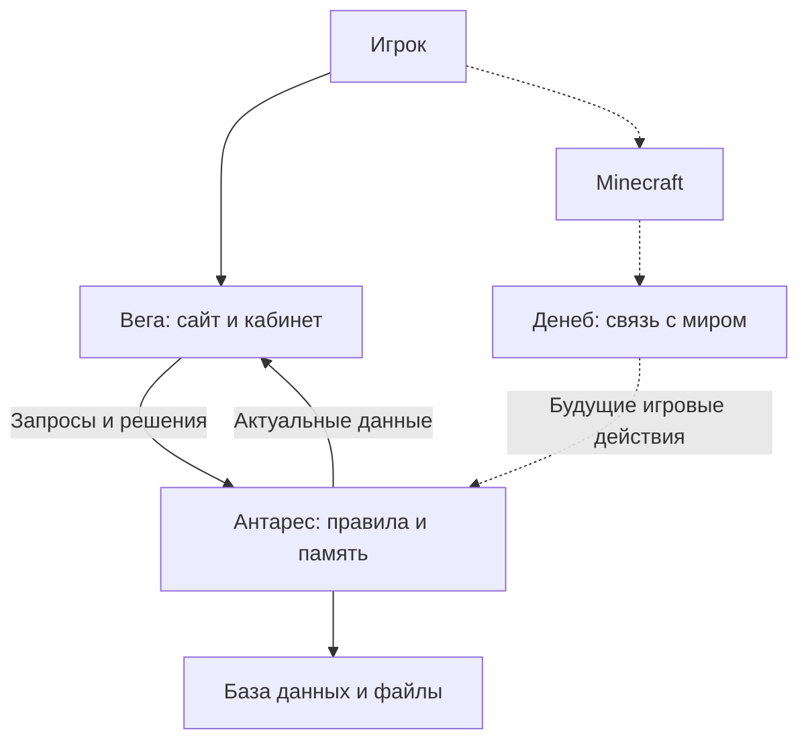
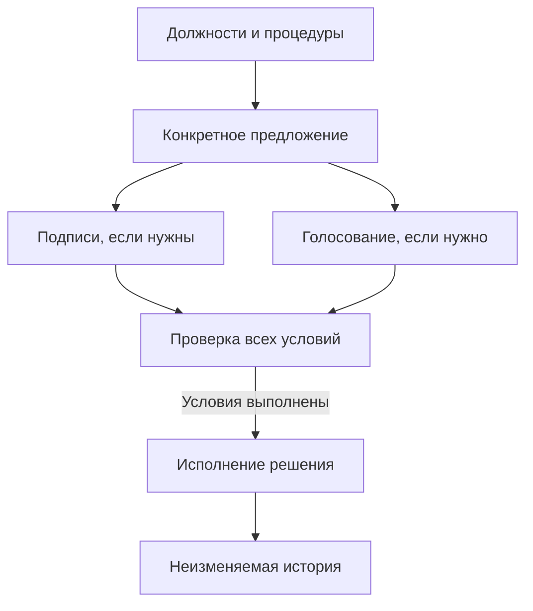
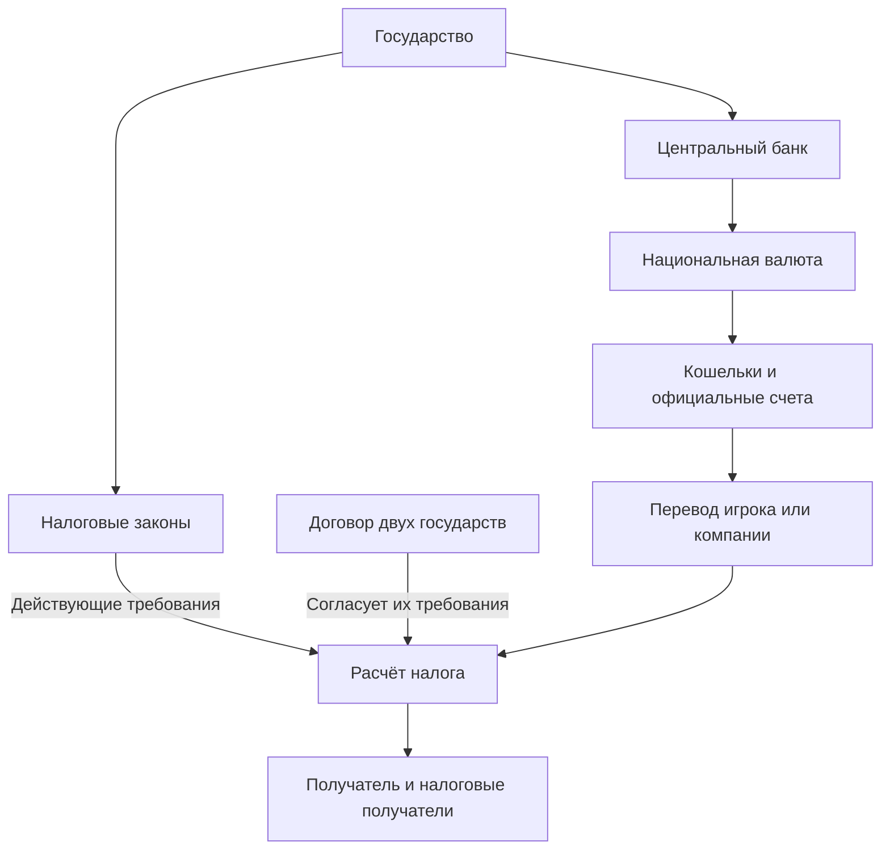
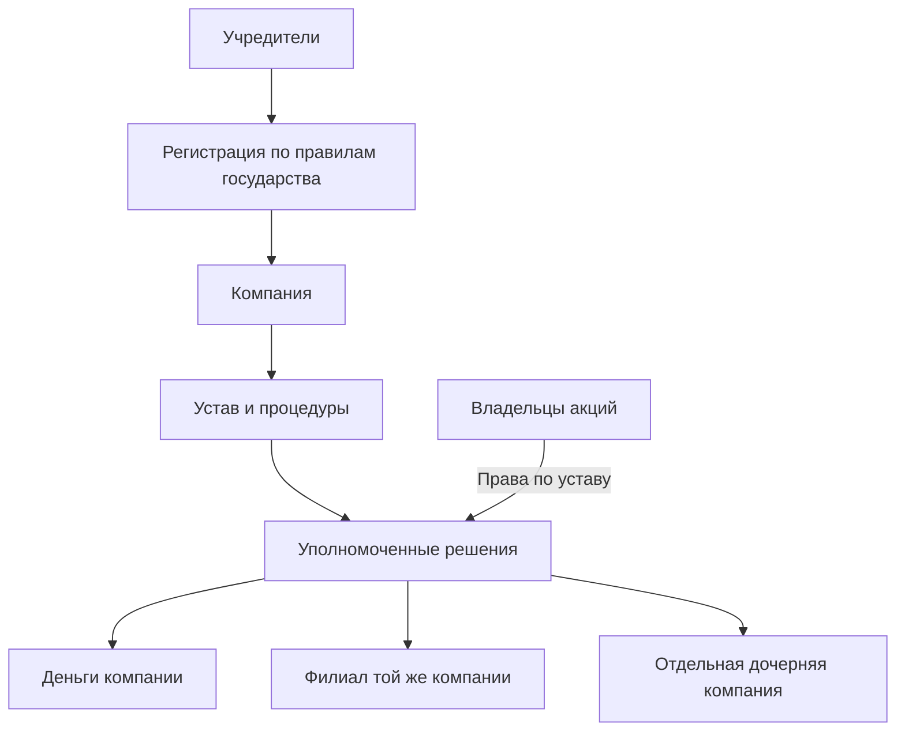
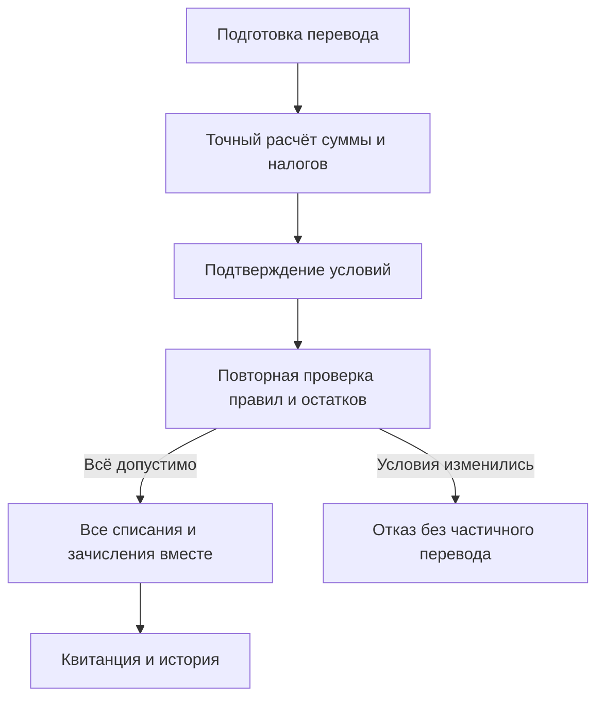
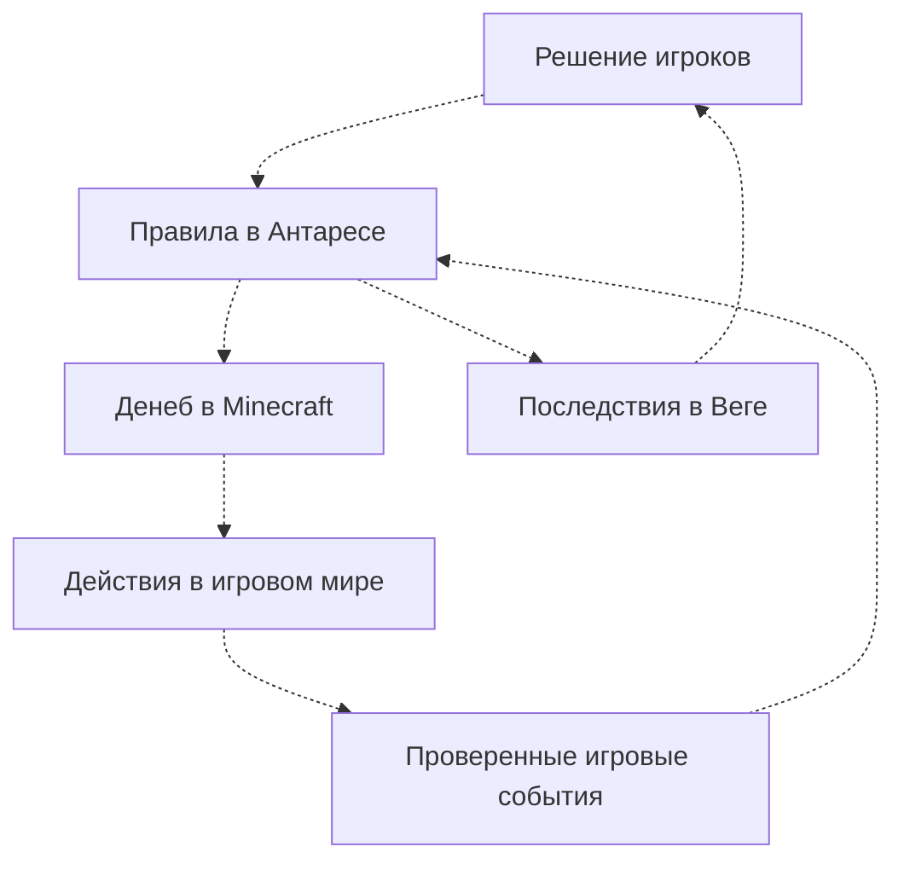

[Документация](../README_RU.md) | [Карта продуктов](../product-map_RU.md)

# HeliCraft для администрации

Готовится постоянный общественный мир, в котором решения игроков имеют последствия: гражданство определяет участие в управлении, устройство государства — порядок принятия решений, а законы и договоры — расчёты между людьми и организациями. Сайт становится второй половиной игры: здесь можно управлять государством, компанией и деньгами между заходами в Minecraft.

Это обзор реализации в репозитории на **21 октября 2026 года**, а не отчёт о запуске на игровом сервере. Сплошные стрелки показывают существующие связи описанных систем; пунктирные — будущие игровые связи. Схемы упрощают детали, которые раскрыты в ссылках под ними.

## 1. Один мир, несколько способов участия

Вега показывает публичные государства, компании, валюты и материалы, а в кабинете позволяет действовать от своего имени и в пределах своих полномочий. Антарес проверяет правила и хранит результат. Только он работает с базой данных и хранилищем файлов.

Денеб пока является основой плагина: проверяет доступность API и содержит базовую геометрию. Границы, собственность и экономические последствия внутри Minecraft ещё предстоит связать с веб-системами. Подробнее: [продуктовая модель](../product-map_RU.md).

## 2. Устройство государства действительно влияет на решения

У каждого действия своя процедура: решение одного должностного лица, нескольких должностей, граждан, совета или их сочетания. Схема показывает возможные доказательства; конкретная процедура определяет, какие из них нужны. Отсутствующее полномочие запрещает действие. Если предусмотрена ручная процедура, администрация фиксирует её проверку с обоснованием; требуемые подписи и голоса всё равно обязательны.

Так работают реформы, назначения, банковские распоряжения, налоговые решения и ратификация договоров. Компании используют тот же подход к явным полномочиям и общий сервис голосований. Список избирателей фиксируется при открытии голосования, а перед исполнением проверяются действующие полномочия. Название формы правления само по себе ничего не разрешает.

Конституция объясняет устройство государства человеку; права определяет структурированная конфигурация. Опубликованные редакции сохраняются, поэтому сегодняшняя реформа не переписывает вчерашнюю Конституцию. Подробнее: [Governance](../states/governance.md), [Constitution](../states/constitution.md), [Voting](../platform/voting.md).

## 3. Государства, деньги и дипломатия связаны правилами

Государство учреждает ЦБ по собственной процедуре, администрация рассматривает учреждение, а выпуск денег требует отдельного полномочия и утверждённой политики. У государства одна национальная валюта; игроки и компании могут держать несколько валют. Переводы перемещают существующие деньги, а эмиссия меняет денежную массу.

Налоги рассчитываются по действующим законам: кто платит, какая ставка и необлагаемая часть, куда поступают средства. Договор может согласовать пересекающиеся требования двух государств; каждая сторона утверждает одинаковые условия по собственной процедуре. Сейчас дипломатия реализована для налоговых договоров. У компаний могут быть собственные национальные налоговые режимы; они не отменяют требования других государств.

Есть и явный обмен двух валют: сделки между ЦБ и конечные предложения игрокам с резервированием средств. Обе стороны обмена исполняются вместе; сам обмен не запускает обычный налог на переводы. Это ещё не биржа с книгой заявок.

Подробнее: [деньги](../economy/monetary_RU.md), [налоги](../economy/taxation_RU.md), [настройки налогов](../economy/taxation-settings_RU.md), [дипломатия](../states/diplomacy_RU.md), [обмен](../economy/currency-exchange_RU.md).

## 4. Компания — отдельный участник мира

У компании есть собственные правила управления, должности, акции, решения и счета. Владение акциями учитывается точно, но доступ к деньгам зависит от финансовой процедуры: одного факта владения может быть недостаточно.

Филиал представляет ту же компанию в другом государстве и не получает отдельный счёт. Дочерняя компания проходит собственную регистрацию, имеет отдельное управление, деньги и историю. Владение материнской компанией не открывает её дочерние счета. Рынок платной торговли акциями пока не реализован.

Подробнее: [Companies](../economy/companies_RU.md).

## 5. Игрок видит условия до исполнения

Суммы хранятся точно, без округления через обычные дробные числа. Перевод и его налоги проходят одной операцией: ошибка не оставляет половину результата. Повтор той же выполненной команды возвращает прежний результат вместо повторного списания. История проведённых операций сохраняется.

Общие сервисы связывают и другие части системы: Voting обслуживает решения и опросы, локализованные тексты — названия и документы, Атриа — общие элементы интерфейса, Альхена — типизированное общение Веги с Антаресом. При этом ответы опроса не подменяют голоса по государственному решению, а публикация новости не создаёт игровое событие.

Подробнее: [денежный учёт](../economy/monetary_RU.md), [локализация](../platform/localized-content.md), [опросы и голосования](../platform/voting.md), [редакционные материалы](../architecture/content_RU.md).

## 6. Как это должно замкнуться на Minecraft

Все стрелки ниже показывают **целевой сценарий**, который ещё предстоит реализовать.

В перспективе границы и юрисдикции, физическая собственность, учреждения, товары и события должны опираться на те же личности и правила, что и сайт. World Engine должен превращать изменения мира в новые поводы действовать. Сейчас территория для налоговых правил использует явно обозначенное приближение по гражданству; реальную географию и здания система ещё не подтверждает.

Ригель подготовлен как основа входного плагина, но собственная игровая аутентификация пока не реализована: сохраняется стандартная проверка официальных аккаунтов. Альтаир пока описан как будущий необязательный desktop-клиент. Эти части требуют отдельной разработки; новый identity-поток — также проверки безопасности.

## Где проходит граница готовности

| Слой                          | Что можно показать по текущей реализации                                                                     |
| ----------------------------- | ------------------------------------------------------------------------------------------------------------ |
| Веб-основа                    | Аккаунты, сессии, скины, публичные профили, материалы, галерея, кабинет и администрация                      |
| Государства                   | Регистрация и проверка, гражданство, должности, процедуры, реформы, Конституция и голосования                |
| Экономика                     | ЦБ, валюты, кошельки, казна, компании, акции, филиалы, налоги, двусторонние налоговые договоры и обмен валют |
| Игровая интеграция            | Основа плагинов; связь перечисленных механик с Minecraft остаётся будущей работой                            |
| Дальнейшая продуктовая модель | Территории, физические активы, рынки товаров, суды, войны, World Engine и Альтаир                            |

Результаты прежних проверок собраны в [Verification](../verification/README.md). Они описывают конкретные прогоны и ограничения среды, а не автоматически подтверждают состояние сервера сегодня.
