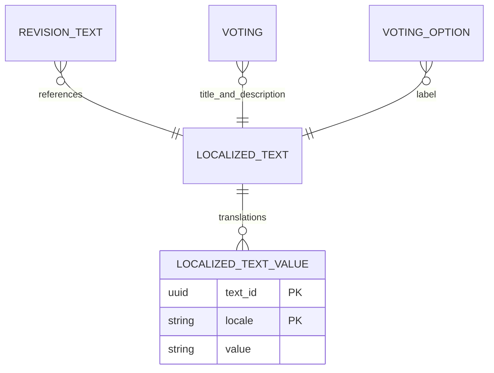

[Repository](../../README.md) | [States](../states/overview.md)

# Localized user content

Use the `LocalizableTextInput` Atria control (Vega `LocalizedInputField` adapter) and the `LocalizedInput` data contract for user-entered display text that can meaningfully be translated. Supported site locales currently are `ru` and `en`. Do not add per-entity `name_ru`/`name_en` columns or create an independent fallback algorithm for each feature.

`localized_texts` identifies a text; `localized_text_values` stores one value per supported locale. Entities or revision text references point to that identity. Published references are created together with their containing revision; a later amendment creates new text identities to preserve historical content.

Resolution returns `{ value, resolvedLocale }` and tries requested locale, English, then remaining `SUPPORTED_LOCALES` in configured order. Empty/whitespace-only values do not stop fallback. Database row order is irrelevant. An empty text resolves to an empty value and null locale.

The controlled localized-input UI preserves all languages while switching and shows translation availability. Slugs, enums, UUIDs and internal keys are not translated. Preset labels are application interface messages, not localized user-content rows.

The existing editorial/gallery translation contracts remain compatible; new state/office/constitution/voting display fields use this shared normalized mechanism.

The shared control uses a native searchable-by-keyboard language selector rather than one button per locale. Completion counts reflect explicit non-empty translations, and switching never copies fallback content into missing values. Many-language and mobile states are documented in Storybook.
