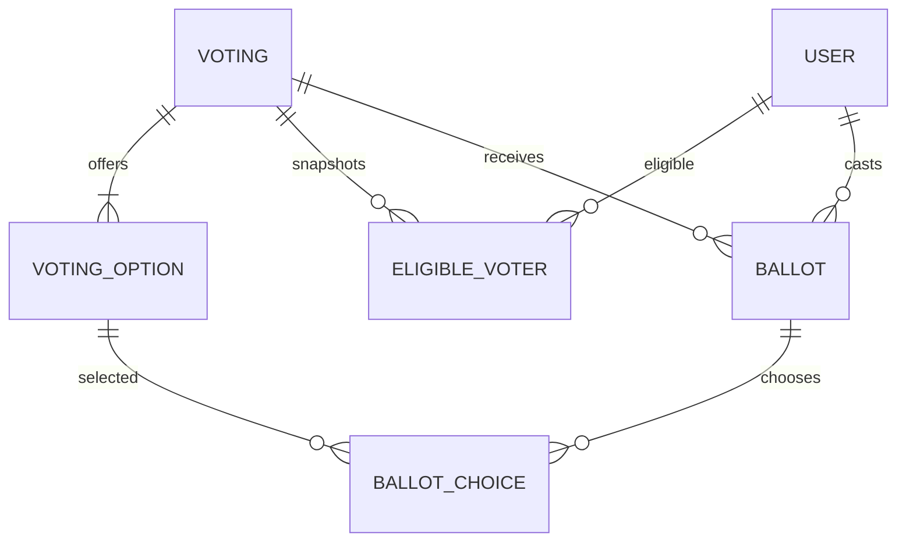

[Repository](../../README.md) | [Governance](../states/governance.md)

# Generic voting service

Voting is an application-wide bounded context. States do not own ballot tables. The global administration poll flow and governance votes share options, electorate snapshots, ballots, selection validation and result calculation.

Statuses are DRAFT, SCHEDULED, OPEN, CLOSED and CANCELLED. Publication validates the window and configuration. The service transitions due votes on operations and a production scheduler polls every 15 seconds. The electorate is frozen transactionally when SCHEDULED transitions to OPEN; snapshot rows are retained after membership changes. Weight is one in V1.

Eligibility providers support global active accounts, specific accounts, active state citizens and current holders of specified offices in an active state. Voting does not infer eligibility from a preset. One locked voting row serializes status changes and ballot submissions. A unique `(voting_id, user_id)` constraint prevents double voting, including concurrent requests.

Quorum counts participation including abstentions against the frozen electorate. Percentage/simple-majority thresholds use non-abstaining ballots; absolute majority and unanimity use the full electorate. Simple/absolute majorities are strict, so a tie fails. Abstention is valid only if enabled and cannot include choices. Multiple selection is bounded by `maxSelections` and cannot repeat an option.

Choice ballots automatically close in the same locked transaction when every frozen eligible voter has participated, including abstentions. Governance rules may additionally set `closeWhenDecided`: once quorum is met, Voting closes when every option has the same approval outcome under the most favorable and least favorable allocation of all remaining weight. This covers approval and irreversible rejection, strict ties, percentage thresholds and exact BigInt share weights. A majority among ballots cast so far is insufficient. Closure retains the published deadline/configuration and writes one audit event; subsequent submissions fail and AFTER_CLOSE results become available immediately. The scheduler applies the same completion check to already-open records.

New state/company draft defaults enable `closeWhenDecided`. Existing immutable revisions without the optional property retain their original configuration and do not opt into decisive closure; they still close at full turnout. Change the rule through the existing state reform or company charter procedure, including per-policy overrides. Generated constitution prose and company Governance summaries describe the effective rule. No schema migration or historical revision rewrite is required. Surveys retain their separate scheduled/manual/repeated-response lifecycle; response distributions are not Governance approval outcomes.

Results are public immediately, available after closing, or restricted to eligible voters; administrators can review them. Governance reforms consume only a closed vote's successful approval option and also enforce the pinned current governance policy.

`/admin/votings` creates and publishes a global poll. `/app/votings` lets eligible authenticated users vote and read permitted results. Timing is displayed in the user's locale.

The admin interface supports saving a global poll draft, publishing it separately, and cancelling an unfinished poll. Explicit opening/closing times control global polls; governance duration defaults remain available in the state wizard. Majority summaries show the selected threshold kind, and the percentage field is disabled when it is not applicable.

## Multi-question community polls

Global polls optionally include ordered `questions`, each with a stable UUID, normalized localized title, references to the existing voting options and its own maximum selections. The admin editor supports adding/removing/reordering questions and answer options. Limits are twenty questions and fifty options in total. Single-question legacy polls retain their existing contract and state/council votes cannot have multiple questions.

Every non-abstaining ballot answers every question, from one answer through that question's maximum. Duplicate choices, options appearing in multiple questions, missing option assignments and partial ballots are rejected. Abstention applies to the whole poll. One ballot remains one participant; result totals are grouped per question, with the same frozen electorate and quorum. The existing global maximum applies to legacy polls; explicit question limits govern grouped polls.

`voting_questions` references shared localized texts; display titles are removed from persisted configuration just like voting/option text. Published grouping is immutable; private drafts can be edited before publication. The existing voting lock and one-ballot unique constraint still serialize submissions. Migration `0010_modern_mandroid.sql` adds question text references and gallery state links without rewriting old voting rows.

Saved administration drafts can be reopened in the fullscreen editor. `PUT /api/v1/admin/votings/:id` requires voting-management authority and the locked DRAFT status, replaces normalized question/option references atomically, and records an audit entry. Published or governance-pinned votes reject editing. Publication shares the same lock, so an edit cannot race past publication.

## Hybrid surveys and decision votes

Administration offers two formats in `/admin/votings`: choice voting (including the existing multi-question polls) and block-based surveys. Creation and draft editing use fullscreen dialogs. Survey drafts autosave after a short pause; manual save/publication share the same serial write queue and retain the created draft ID if publication fails.

Surveys restore the working archived forms capabilities: short text, paragraphs, single choice, checkboxes, dropdowns, text blocks, and image blocks. Blocks can be inserted before/after, duplicated with independent option IDs, removed, and reordered with keyboard-accessible buttons or drag and drop. Each question has localized titles/descriptions, requiredness and appropriate selection/text-length limits. Image blocks select or upload gallery images, support localized captions and grid, carousel, random and vertical display. Uploads use the existing gallery processing/storage pipeline and are also published in the public gallery, as stated in the editor. Text blocks support normal, information, warning and success styling; Antares renders and sanitizes their Markdown for every supported locale. Unsaved previews show source text.

Surveys may accept one response per account or repeated responses, and close at a scheduled time or remain open until an administrator closes them. A closed survey can reopen with the original electorate snapshot and responses. Reopening a scheduled survey that was manually closed before its first opening still takes its snapshot at actual opening. Archiving hides a survey and its direct link from participants while retaining administration access. Published structures remain immutable; administrators can copy a survey into a new draft for changes. Sharing uses protected `/app/votings/:id` links and still requires authentication.

Administration provides response totals, per-question counts and distributions (bars/pie charts), and paginated individual answers with account identity and submission time. Deleting a response requires voting-management authority, is scoped to its survey, locks the same voting row as submission, updates subsequent statistics and records an audit entry. Removing the only response permits that account to respond again. Raw text responses and respondent identities are never returned through participant result endpoints.

This is one shared voting platform: survey answers are typed JSON on `voting_ballots`, not a separate ballot system. `voting_one_ballot` remains unique for standard ballots and surveys limited to one response; repeated survey submissions receive a non-null repeat key and are serialized by the existing voting lock. All survey display text is stored through the shared localized-text mechanism. Migration `0012_glamorous_synch.sql` adds these fields, localized survey text references, the partial unique index and the archived status check without rewriting existing ballots.

State/council votes and governance-bound decisions reject survey configuration. Their single ballot, abstention, quorum, threshold, electorate snapshots, immutable governance references and result-consumption rules are unchanged. A survey response cannot be submitted as a decision ballot or vice versa. Survey distributions do not imply approval of a governance decision.

The archived `rating`, `file_upload`, anonymous-submission and theme fields were declarations without functioning editor/renderer support; they are not advertised as restored features. No archive runtime or database is imported.
