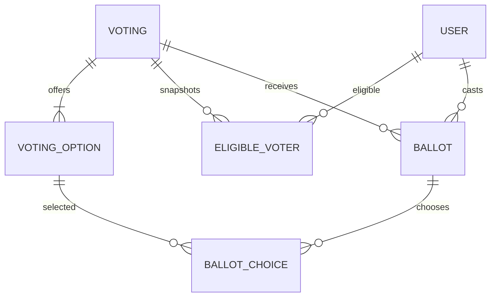

[Repository](../../README.md) | [Governance](../states/governance.md)

# Generic voting service

Voting is an application-wide bounded context. States do not own ballot tables. The global administration poll flow and governance votes share options, electorate snapshots, ballots, selection validation and result calculation.

Statuses are DRAFT, SCHEDULED, OPEN, CLOSED and CANCELLED. Publication validates the window and configuration. The service transitions due votes on operations and a production scheduler polls every 15 seconds. The electorate is frozen transactionally when SCHEDULED transitions to OPEN; snapshot rows are retained after membership changes. Weight is one in V1.

Eligibility providers support global active accounts, specific accounts, active state citizens and current holders of specified offices in an active state. Voting does not infer eligibility from a preset. One locked voting row serializes status changes and ballot submissions. A unique `(voting_id, user_id)` constraint prevents double voting, including concurrent requests.

Quorum counts participation including abstentions against the frozen electorate. Percentage/simple-majority thresholds use non-abstaining ballots; absolute majority and unanimity use the full electorate. Simple/absolute majorities are strict, so a tie fails. Abstention is valid only if enabled and cannot include choices. Multiple selection is bounded by `maxSelections` and cannot repeat an option.

Results are public immediately, available after closing, or restricted to eligible voters; administrators can review them. Governance reforms consume only a closed vote's successful approval option and also enforce the pinned current governance policy.

`/admin/votings` creates and publishes a global poll. `/app/votings` lets eligible authenticated users vote and read permitted results. Timing is displayed in the user's locale.

The admin interface supports saving a global poll draft, publishing it separately, and cancelling an unfinished poll. Explicit opening/closing times control global polls; governance duration defaults remain available in the state wizard. Majority summaries show the selected threshold kind, and the percentage field is disabled when it is not applicable.
