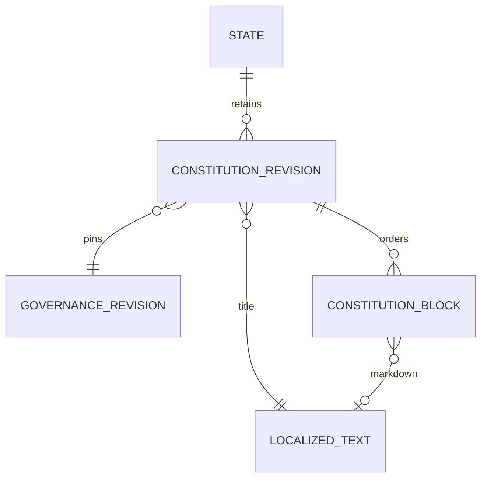

[Overview](overview.md) | [Governance](governance.md)

# Constitution documents

Machine-readable governance is required for every state. A formal constitution is optional and separate from future laws. Document prose and placeholders do not grant capabilities.

The editor is one localized text document. It offers visual formatting (headings, emphasis, paragraphs, nested lists, quotes, undo/redo), a lossless editable Markdown source and a template. Enter creates a paragraph; Shift+Enter creates a hard line break. Indent/outdent buttons and Tab/Shift+Tab nest lists. In source mode Tab inserts four spaces and Shift+Tab removes leading indentation; Escape then Tab leaves the field. All submitted text is stored as Markdown through normalized localized content. A single MARKDOWN block holds newly edited documents. Existing ordered MARKDOWN/GENERATED documents remain readable and are converted to equivalent Markdown tokens only when edited, preserving their order, references and language fallback.

The live preview is rendered and sanitized by Antares after a 350 ms debounce. Its query includes the configuration snapshot and document language; obsolete requests are cancelled, and stale results are not presented as the current document. The fullscreen preview uses the same data and supports language selection. A document is rendered continuously, without block cards. Soft line breaks, hard line breaks, nested lists and GFM tables are retained. Raw HTML and unsafe links remain disabled by the shared sanitize pipeline.

## Inline placeholders

| Token                         | Value                                                  |
| ----------------------------- | ------------------------------------------------------ |
| `{{state.name}}`              | Localized name with platform fallback                  |
| `{{state.description}}`       | Localized description                                  |
| `{{state.slug}}`              | Stable public slug                                     |
| `{{founders}}`                | Founder nicknames with player heads                    |
| `{{citizenship.rules}}`       | Actual entry/multiple-citizenship settings in prose    |
| `{{voting.rules}}`            | Actual default quorum, threshold and duration in prose |
| `{{office.UUID.name}}`        | Name of the referenced office                          |
| `{{office.UUID.description}}` | Description of the referenced office                   |

Placeholders can appear in custom prose. Backtick/code-fence examples remain literal. User values are escaped as Markdown data, rather than treated as instructions. The renderer also understands escaped underscores produced by the visual Markdown serializer. Unknown or deleted references remain visible and are reported in the editor.

## Generated paragraphs and sections

`{{block.STATE_IDENTITY}}`, `{{block.FOUNDERS}}`, `{{block.CITIZENSHIP_RULES}}`, `{{block.OFFICES_OVERVIEW}}`, `{{block.VOTING_RULES}}` and `{{block.GOVERNANCE_SUMMARY}}` produce readable paragraphs or full sections. For example, FOUNDERS states that the named state was founded by its named players and that the founders form its initial citizen body. Governance describes appointment, term, vacancy, inactivity and real decision procedures, rather than listing labels alone.

`{{block.SINGLE_OFFICE:UUID}}` and `{{block.OFFICE_APPOINTMENT_RULE:UUID}}` describe one office. `{{block.STATE_DECISION_RULE:ACTION}}` describes one configured action. The insertion picker shows human-readable names and carries stable office/action references. Generated sections are separated as paragraphs even when inserted next to custom prose. Expanded documents are limited to 1,000,000 characters, with the same bound checked before state/reform publication.

Generated text is derived at read time, not stored as editable merged prose. Published constitution revisions pin their governance revision. Historical sections and placeholders use that pinned configuration; current offices cannot rewrite historical text. The server renderer is shared by draft preview, approved public SSR, protected historical reads and reform proposals. Public DTOs contain sanitized HTML and omit raw Markdown.

Reform publication creates a new governance revision and linked constitution revision. Administrative corrections follow the same immutable revision mechanism. The proposals page explains review/approval, provides a clear empty/loading/error state, creates a reform draft and links back to its state.
