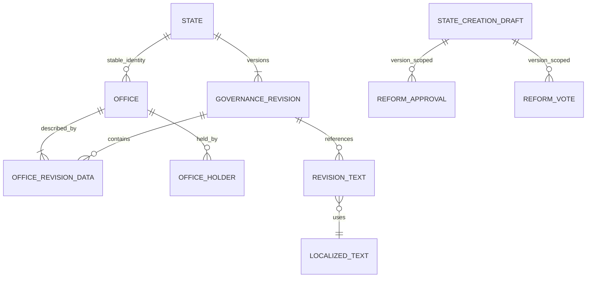

[Overview](overview.md) | [Constitution](constitution.md) | [Voting](../platform/voting.md)

# Governance

Authority derives from stable office identities, versioned office rules and per-action decision policies. A preset is an initializer, never a government type or permission source. The six initial choices are Autocracy, Constitutional Monarchy, Presidential Republic, Council Republic, Direct Democracy and Custom.

Offices support multiple holders, optional heads of state, required/vacant seats, appointment by another office, citizen/council election and a manual procedure. Terms can be indefinite or fixed. An inactivity threshold permits initiating succession; it never automatically removes a holder.

Policies support single/any/all offices, citizen/council votes, combined office approvals and citizen votes, and documented manual procedures. The V1 wizard configures amendments, law adoption/repeal (tax laws in V1), admission/removal of citizens and appointment/removal of holders. Taxation and bilateral diplomacy reuse immutable economic directives and generic Voting; other future action codes do not implement their domains. See [Taxation](../architecture/taxation.md) and [Diplomacy](../architecture/diplomacy.md).

A reform draft pins its base governance revision. Publication rejects a stale base. Submitting for review creates an immutable, normalized proposal identified by its base revision and canonical configuration hash. Approvals and voting refer to that proposal, so navigating steps or renaming a private draft does not invalidate approvals. Editing configuration supersedes the proposal; restoring the exact configuration can reuse it. Publication rechecks current office holders and their fixed terms. Citizen/council voting uses the generic service and a frozen electorate. Combined decisions require both the office approvals and a closed successful vote. Manual procedures require a reasoned administrative override. Administrator changes create a new immutable revision with actor, reason and previous revision ID.

Machine configuration is a typed revision snapshot. Display fields are stripped from that snapshot and stored as normalized localized-text references keyed by one central traversal. Office revision membership and holder intervals retain identity across amendments. Submitted revisions are never updated by application services.

Human-readable policy/generated summaries use the configured threshold kind, including simple/absolute majorities and unanimity, rather than displaying the unused percentage field. Draft reviews distinguish initial office-holder assignments from current published holder intervals.

Historical membership/holder reads compare against the exact PostgreSQL revision timestamp. Holder corrections close and reopen intervals at the same transaction timestamp; JavaScript millisecond rounding must not select the previous assignment at a revision boundary.

New offices in reform proposals may select current active citizens for their initial roster. Existing offices retain their original roster, even when a founder has left; changing existing holders requires the separate office procedure. Initial state creation retains its founder-only rule. Both eligibility and current approval authority are revalidated during publication. Voluntary departure preserves history and requires all current office appointments to end first; existing electorate snapshots do not change.

## Office decisions

`state_office_assignments` stores an immutable appointment/removal payload pinned to a governance revision, target office, candidate and optional replaced holder. It has only pending, applied and cancelled lifecycle states. PostgreSQL guards the payload and completed history. The service rechecks active citizenship, office capacity, required-office succession, current revision and the applicable vacancy rule under the state lock before applying. Replacement joins both appointment and removal policies. Preset metadata supplies no authority.

Approvals refer to the proposal and stable office identities. A signature counts only while its signer still holds the same uninterrupted, unexpired office term with an active account. Reappointment cannot revive an earlier signature; the holder must sign again. Any/all policy groups and the appointment authority are conjunctive requirements. Identical electorates and voting rules may share one generic vote; different rules retain separate votes. All elections remain single-question votes with frozen electorates and a subject bound to the immutable proposal. No appointment-specific ballots exist.

Manual procedures require a current administrator with `states.manage`, a recorded reason, and all other structured proofs. Administration cannot bypass a missing vote or office approval through this procedure. Apply closes the previous holder and starts the successor at the exact same PostgreSQL transaction timestamp without rewriting governance history. Cancellation retains the proposal and cancels its unfinished votes.

## Institutional procedure organization

`CREATE_INSTITUTION` is the shared authority for establishing the central bank and tax office. A newly configured shared policy takes precedence over the older establishment-specific policies. Without it, legacy published policies still govern their existing action; immutable historical revisions are never rewritten. Subsequent bank/tax actions retain their distinct policies and are grouped under their institution in the reform editor. Missing procedures still deny actions. No authority is inferred from a title or preset.

Institution establishment may carry `initialPolicies` for that institution only. Existing configured policies must remain identical; changing them requires a reform. Office references and complete voting rules are validated before proposal creation and again at execution. Procedure text is normalized through `institution_policy_texts`, while the immutable directive payload stores only machine data. Approval of establishment appends a governance revision and matching pinned constitution in the same transaction as the institution. Earlier revisions and holder intervals remain untouched. Migration `0019_harsh_thunderbolts.sql` adds immutable procedure-text references.
