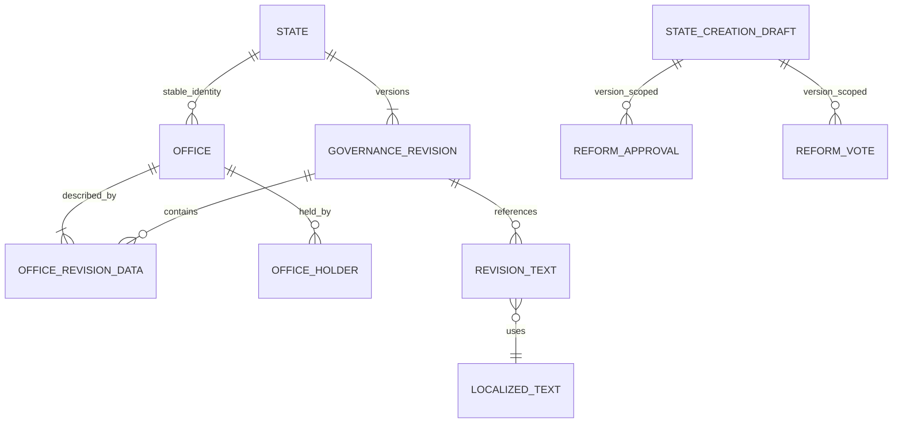

[Overview](overview.md) | [Constitution](constitution.md) | [Voting](../platform/voting.md)

# Governance

Authority derives from stable office identities, versioned office rules and per-action decision policies. A preset is an initializer, never a government type or permission source. The six initial choices are Autocracy, Constitutional Monarchy, Presidential Republic, Council Republic, Direct Democracy and Custom.

Offices support multiple holders, optional heads of state, required/vacant seats, appointment by another office, citizen/council election and a manual procedure. Terms can be indefinite or fixed. An inactivity threshold permits initiating succession; it never automatically removes a holder.

Policies support single/any/all offices, citizen/council votes, combined office approvals and citizen votes, and documented manual procedures. The V1 wizard configures amendments, future law adoption/repeal, admission/removal of citizens and appointment/removal of holders. Future action codes do not implement those future domains.

A reform draft pins its base governance revision. Publication rejects a stale base. Submitting for review creates an immutable, normalized proposal identified by its base revision and canonical configuration hash. Approvals and voting refer to that proposal, so navigating steps or renaming a private draft does not invalidate approvals. Editing configuration supersedes the proposal; restoring the exact configuration can reuse it. Publication rechecks current office holders and their fixed terms. Citizen/council voting uses the generic service and a frozen electorate. Combined decisions require both the office approvals and a closed successful vote. Manual procedures require a reasoned administrative override. Administrator changes create a new immutable revision with actor, reason and previous revision ID.

Machine configuration is a typed revision snapshot. Display fields are stripped from that snapshot and stored as normalized localized-text references keyed by one central traversal. Office revision membership and holder intervals retain identity across amendments. Submitted revisions are never updated by application services.

Human-readable policy/generated summaries use the configured threshold kind, including simple/absolute majorities and unanimity, rather than displaying the unused percentage field. Draft reviews distinguish initial office-holder assignments from current published holder intervals.

Historical membership/holder reads compare against the exact PostgreSQL revision timestamp. Holder corrections close and reopen intervals at the same transaction timestamp; JavaScript millisecond rounding must not select the previous assignment at a revision boundary.
