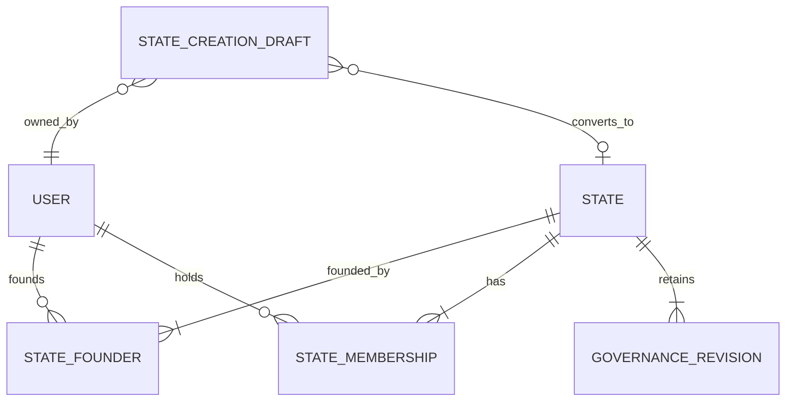

[Repository](../../README.md) | [Governance](governance.md) | [Creation](creation-flow.md)

# States V1

Antares owns states, citizenship, governance and their audit history. Vega reads the generated Alhena contract. Neither Vega nor Minecraft plugins access PostgreSQL or object storage.

A state exists only after its creation draft is submitted. Submission creates founders, full citizenship, stable offices, initial holders and the first governance/optional constitution revision in one transaction. The draft remains as a converted record.

`CREATED` awaits administrative review. Allowed transitions are `CREATED → ACTIVE`, `CREATED → REJECTED`, `ACTIVE → SUSPENDED`, and `SUSPENDED → ACTIVE`. Administrative decisions require a reason and produce audit entries. Suspended/rejected records remain in history. Public endpoints expose only ACTIVE states; founders and administrators can inspect pending configuration. Future DORMANT/DISSOLVED enum values do not introduce additional transitions yet.

Territories, claims, institutions, law CRUD, economy, currencies, treasury, diplomacy, courts and war are outside V1. Their action keys can be added to policies without using presets as authority.

Flags have separate designs. Minecraft banners persist a base dye and up to six ordered pattern/dye layers. Horizontal flags either use an independent banner design or validated PNG media. Copying a vertical design does not couple subsequent edits. PNG uploads pass MIME, signature, decoded-dimension and byte-size checks, are normalized by Sharp, and use the shared private S3 abstraction. Draft media requires its owner; public flag URLs require an ACTIVE state.

## Public directory and homepage

Public `GET /api/v1/public/states` returns a bounded directory of ACTIVE states from their current published governance revisions. Summaries contain normalized localized names/descriptions, actual horizontal flags, current citizen counts, citizenship settings, office counts and formal constitution availability. Private drafts and Markdown bodies are excluded. Count, page and translations are read in one repeatable-read snapshot without per-state queries.

Search matches the stable slug and all supported name/description translations, case-insensitively; SQL wildcard characters are treated literally. Filters use actual citizenship entry mode and constitution presence. Sorts are newest, localized name (the platform fallback order) and active citizen count, with deterministic ID tie-breaks. Page sizes are bounded to 48 and an out-of-range page resolves to the last available page.

Vega `/states` preserves search, filters, sort, language and pagination in GET URLs and works without JavaScript. Cards link by stable slug, including renamed states. The homepage shows up to three approved states ordered by current citizen count and the directory total. Both pages distinguish an empty directory from an unavailable API, and public SSR clients omit credentials. Desktop/mobile headers link to `/states`.

## State presentation

Public and account state detail pages share a responsive composition with a state-color accent, correctly proportioned flags, real population and office counts, founders, citizenship rules, current office holders and Constitution document. Native section links and disclosure controls work without JavaScript. Private moderation reasons and authenticated flag URLs remain confined to account/admin views. Founders, citizens and office holders link to their public player profiles. Administrative and reform actions remain in their protected route composition.
